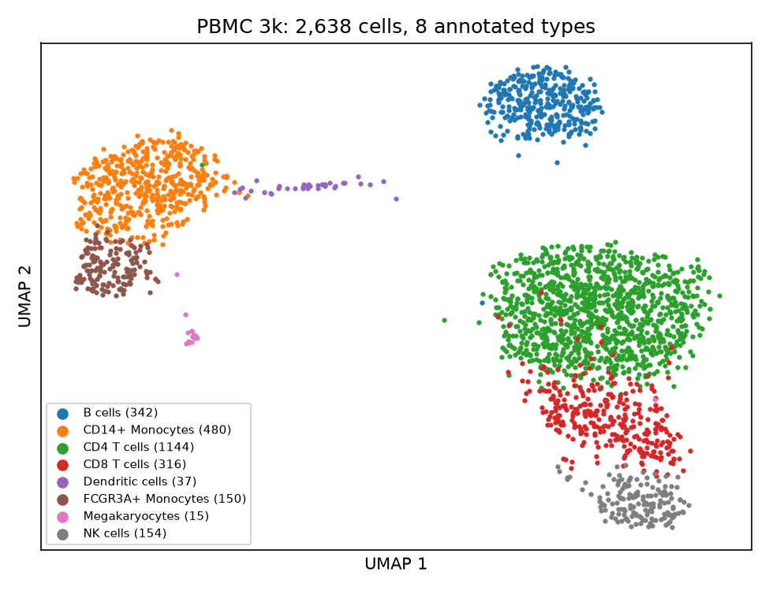
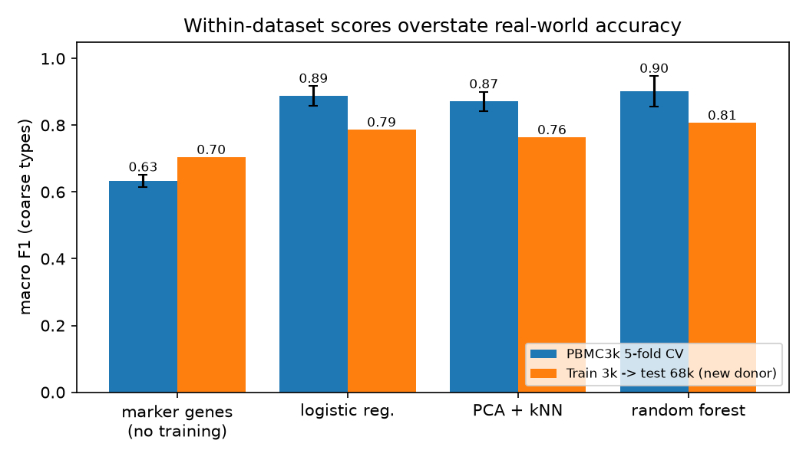
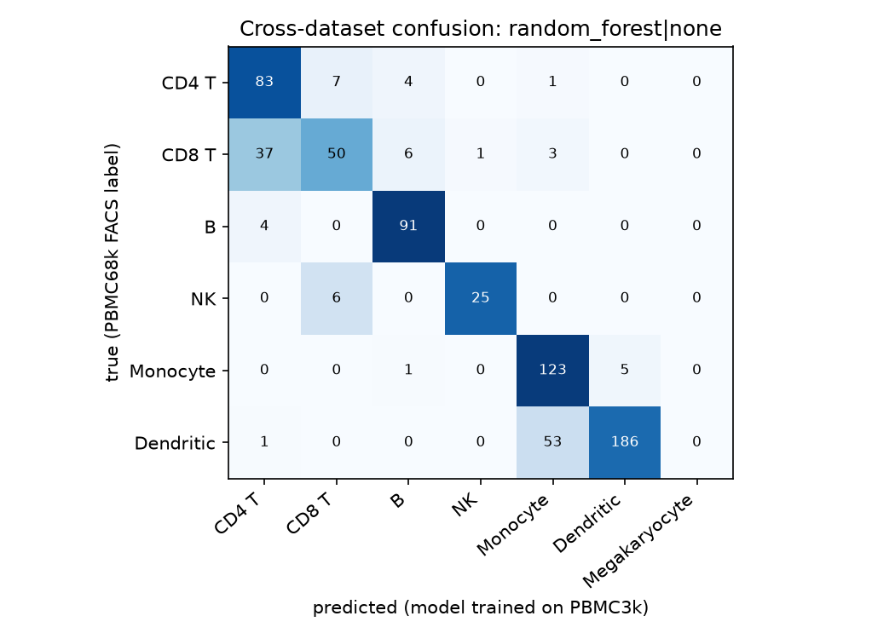

# PBMC Cell-Type Classifier (single-cell RNA-seq, tested on a new donor)

[](https://github.com/zainab-123-spec/pbmc-celltype-classifier/actions/workflows/ci.yml)


Single-cell RNA sequencing measures the expression of about 30,000 genes in each individual cell.
A common first task is to decide **which immune cell type** each cell is. This project trains
classifiers on peripheral blood mononuclear cells (PBMCs) and asks a question most tutorials skip:

> **Does a model that scores 90%+ inside one dataset still work on cells from a different donor?**



## Data (all public, no login)

| dataset | cells | labels come from | source |
|---|---|---|---|
| **PBMC 3k** (train + CV) | 2,638 annotated | the standard Seurat/scanpy tutorial clustering + marker genes | raw counts: [10x Genomics](https://cf.10xgenomics.com/samples/cell-exp/1.1.0/pbmc3k/pbmc3k_filtered_gene_bc_matrices.tar.gz) (7.6 MB, fetched by `scripts/download_data.py`); labels: `data/pbmc3k_labels.csv` (from `scanpy.datasets.pbmc3k_processed`) |
| **PBMC 68k reduced** (external test) | 700 (687 used) | correlation with FACS-sorted bulk profiles (Zheng et al., *Nat. Commun.* 2017) | ships inside `scanpy` |

The two datasets come from **different donors** and were labelled by **different methods**, so the
second one is an honest external test. The 8 fine PBMC 3k types and 10 PBMC 68k types are mapped to
7 shared coarse types (CD4 T, CD8 T, B, NK, Monocyte, Dendritic, Megakaryocyte). The 13 CD34+ cells
in 68k have no equivalent in 3k and are dropped.

PBMC 3k is also a popular Kaggle dataset. This version needs no Kaggle account.

## Method

* **Pre-processing (hand-written, `scpbmc/preprocess.py`)**: library-size normalisation to 10,000
  UMIs, then `log1p`. Genes seen in fewer than 3 cells are dropped (13,656 genes remain). This
  filter uses no labels.
* **Gene selection inside each fold**: the 2,000 most variable genes are chosen on the *training
  fold only*, inside an sklearn `Pipeline`. This avoids leaking test-set information.
* **Models**: L2 logistic regression (C=0.1), PCA(50) + kNN(15), and a class-balanced random forest
  (300 trees).
* **No-training baseline**: a marker-gene rule. Each cell is assigned the type whose textbook
  markers (e.g. *MS4A1* for B cells, *LYZ* for monocytes) have the highest mean z-score.
* **Evaluation**: 5-fold stratified CV (mean ± sd over folds) and train-on-3k / test-on-68k on the
  764 genes both datasets share. Macro F1 is the main metric because the classes are very
  imbalanced (1,144 CD4 T cells vs 15 megakaryocytes).

## Results (real, from `results/metrics.json`)

### 1. Within PBMC 3k, 5-fold CV

| model | fine labels (8 types) macro F1 | coarse labels (7 types) macro F1 | coarse accuracy |
|---|---|---|---|
| marker genes (no training) | n/a | 0.633 ± 0.018 | 0.761 ± 0.015 |
| logistic regression | 0.878 ± 0.026 | 0.888 ± 0.029 | 0.947 ± 0.010 |
| PCA + kNN | 0.871 ± 0.022 | 0.872 ± 0.029 | 0.930 ± 0.010 |
| random forest | **0.895 ± 0.026** | **0.902 ± 0.046** | **0.950 ± 0.008** |

### 2. Train on PBMC 3k, test on PBMC 68k (new donor, 687 cells)

| model | macro F1 | accuracy | balanced accuracy |
|---|---|---|---|
| marker genes (no training) | 0.704 | 0.734 | 0.783 |
| logistic regression | 0.786 | 0.798 | 0.798 |
| PCA + kNN | 0.763 | 0.789 | 0.779 |
| random forest | **0.807** | **0.812** | **0.814** |
| logistic regression + per-dataset z-score | 0.546 | 0.518 | 0.625 |
| random forest + per-dataset z-score | 0.627 | 0.595 | 0.678 |



### What the numbers say

1. **Within-dataset CV is optimistic.** Logistic regression on the *same 764 shared genes* gets
   macro F1 0.918 ± 0.039 in PBMC 3k CV, but 0.786 on the new donor. The drop of about 0.13 comes
   from donor, batch and labelling differences, not from having fewer genes.
2. **The learned models still beat the marker rule across datasets** (0.807 vs 0.704 macro F1).
   The gap is much smaller than within one dataset, though (0.902 vs 0.633).
3. **Errors are biologically sensible.** In the random forest confusion matrix below, 37 of 97
   CD8 T cells are called CD4 T, and 53 of 240 FACS "Dendritic" cells are called monocytes. Both
   pairs are closely related lineages.
4. **A "batch correction" made things worse.** Z-scoring each dataset separately assumes both have
   the same cell-type mix. They don't: dendritic cells are 34.9% of the 68k subset but 1.4% of
   PBMC 3k. Centring each dataset on its own mean therefore shifts every cell. This is a negative
   result worth knowing.



### Honest limitations

* PBMC 3k labels were made by clustering the same data, so within-dataset CV partly measures
  "can the model re-find the clusters". That is why the external test matters.
* PBMC 68k `bulk_labels` are themselves noisy (correlation to bulk FACS profiles, not ground truth),
  so part of the cross-dataset "error" is label noise.
* The external test set is small (687 cells, 31 NK). There are no megakaryocytes in it.
* Only 764 genes are shared, because scanpy ships a reduced version of 68k.

## Run it

```bash
pip install -r requirements-dev.txt && pip install -e .
python scripts/download_data.py      # 7.6 MB from 10x Genomics
python -m scpbmc.evaluate            # ~2 min on 8 CPU cores -> results/metrics.json
python -m scpbmc.plots               # -> results/figures/
pytest -q                            # 20 tests, no network needed
```

* `notebooks/pbmc_walkthrough.ipynb`: guided tour with the results.
* `kaggle/pbmc-celltype-cross-donor-kaggle.ipynb`: self-contained Kaggle version (see
  [KAGGLE_UPLOAD.md](KAGGLE_UPLOAD.md)).
* [LEARNING_GUIDE.md](LEARNING_GUIDE.md): plain-language explanation and interview Q&A.

## Project layout

```
scpbmc/data.py        download + load PBMC3k / 68k, label maps
scpbmc/preprocess.py  log-normalisation, per-dataset z-score, fold-safe gene selection
scpbmc/models.py      marker-gene baseline + sklearn pipelines
scpbmc/evaluate.py    CV and cross-dataset experiments
scpbmc/plots.py       README figures
tests/                20 pytest tests (synthetic data)
```

## References

* 10x Genomics, *3k PBMCs from a Healthy Donor* (2016).
* Zheng G.X.Y. et al. Massively parallel digital transcriptional profiling of single cells.
  *Nat. Commun.* 8, 14049 (2017).
* Wolf F.A., Angerer P., Theis F.J. SCANPY. *Genome Biology* 19, 15 (2018).

MIT License © 2026 Zainab Javed
